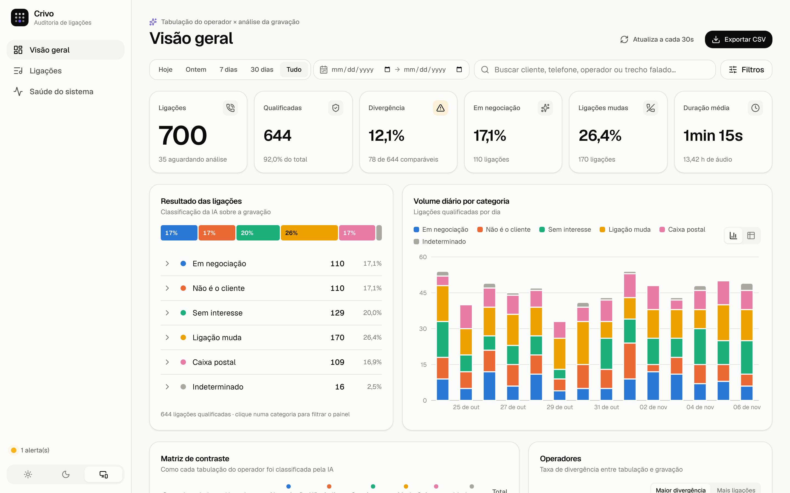
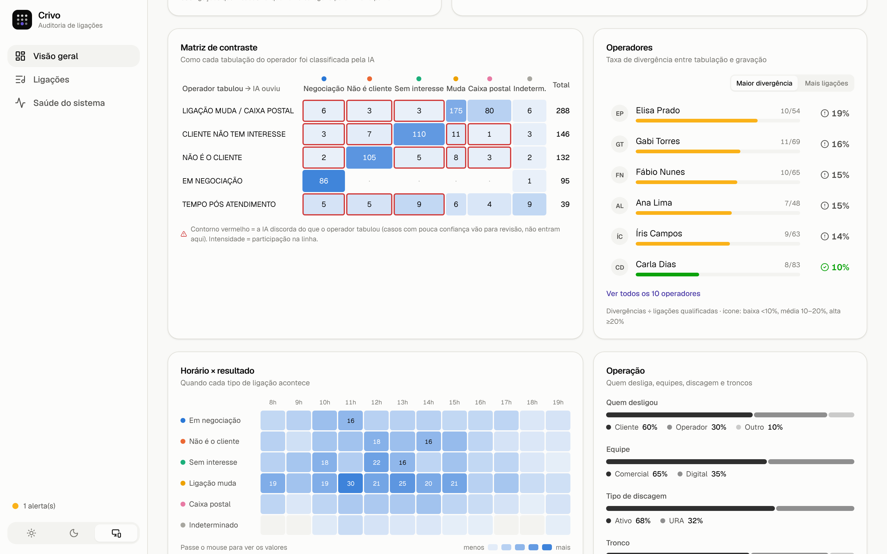
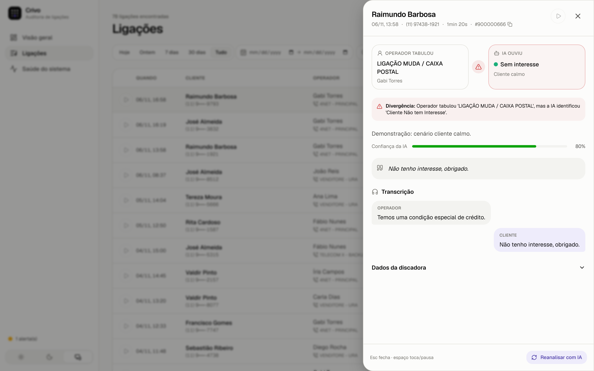
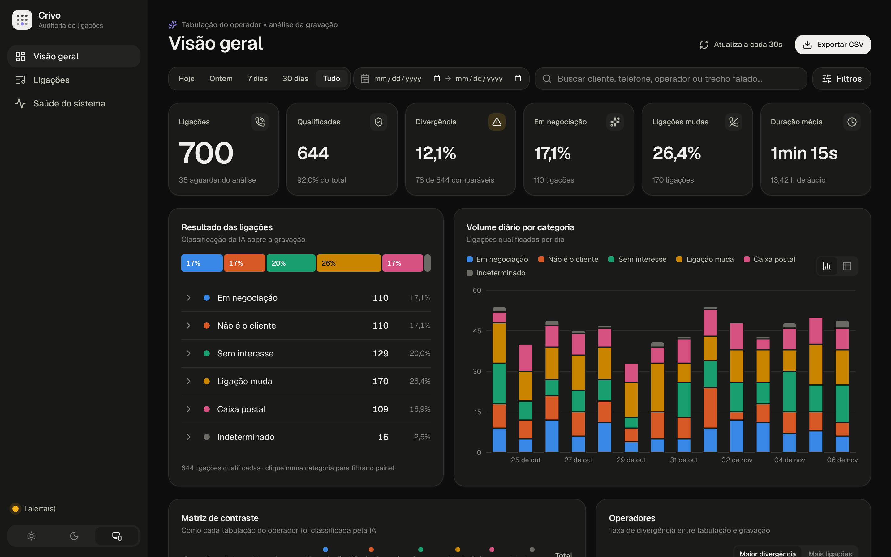
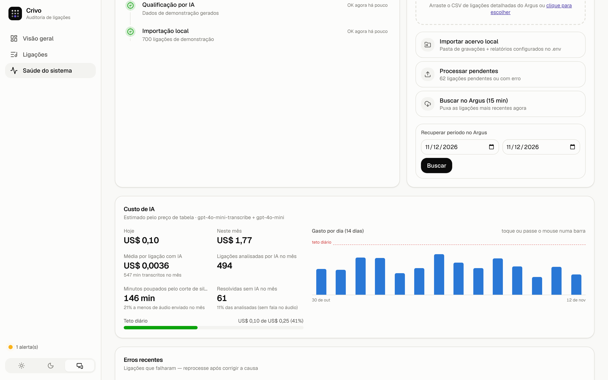
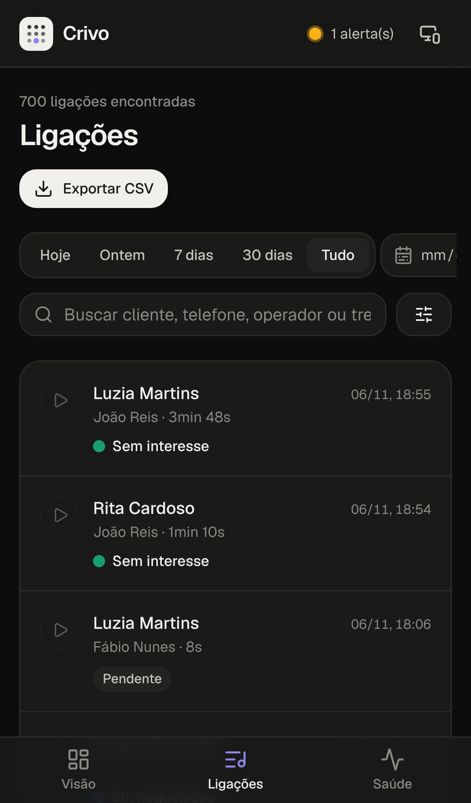
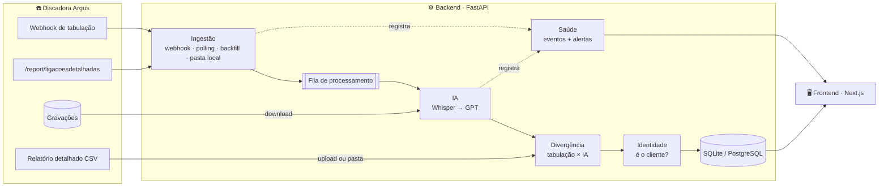

<div align="center">


# Crivo

**Auditoria de ligações: o que o operador tabulou × o que a gravação realmente mostra.**

Cruza os dados da discadora **Argus** com a análise de **IA** sobre cada gravação para dar uma visão clara<br/>
do panorama das ligações, medir a qualidade da tabulação e monitorar a operação em tempo real.

<p>
  
  
  
  
  
  
  
</p>

<a href="#-começando">Começando</a> ·
<a href="#-como-funciona">Como funciona</a> ·
<a href="#%EF%B8%8F-configuração">Configuração</a> ·
<a href="#-custo-de-ia">Custo de IA</a> ·
<a href="#-api">API</a> ·
<a href="#%EF%B8%8F-roadmap">Roadmap</a>

<br/><br/>



<sub>Telas com <b>dados fictícios</b> gerados por <code>scripts/seed_demo.py</code>.</sub>

</div>

---

## ✨ O que o Crivo entrega

<table>
<tr>
<td width="50%" valign="top">

### 🎯 Matriz de contraste
Para cada tabulação feita no Argus, mostra como a IA classificou a gravação. Células com **contorno vermelho** são divergências: o operador marcou uma coisa e a ligação foi outra.

</td>
<td width="50%" valign="top">

### 👥 Ranking de operadores
Taxa de divergência **sobre ligações qualificadas**, com faixas baixa/média/alta. Um clique filtra o painel inteiro pelo operador.

</td>
</tr>
<tr>
<td valign="top">

### 🎧 Escuta rápida
Player fixo com fila, velocidade de 1× a 2× e atalhos (`espaço`, `←` `→`, `Shift+←/→`). Na lista, `j`/`k` navega e `Enter` abre o detalhe com transcrição em formato de conversa.

</td>
<td valign="top">

### 🩺 Saúde do sistema
Último webhook, polling, downloads e IA, com **alertas acionáveis** (webhook silencioso, token inválido, fila acumulada, erros). Upload do relatório da discadora com arrastar e soltar.

</td>
</tr>
<tr>
<td valign="top">

### 🔗 Links compartilháveis
Todos os filtros e a ligação aberta ficam na URL. Mande `…/ligacoes?operador=Ana&divergencia=true&ligacao=123` para alguém e a pessoa vê exatamente a mesma coisa.

</td>
<td valign="top">

### 📱 Responsivo e com tema
Funciona do celular ao monitor ultrawide. Tema claro, escuro ou do sistema. Paleta de categorias **validada para daltonismo**, e toda cor vem acompanhada de rótulo ou ícone.

</td>
</tr>
<tr>
<td valign="top">

### 👂 Sem segurança, não acusa
Se a IA não entende o áudio ou tem confiança baixa, a ligação **não vira divergência**: vai para a fila de *revisão humana*, com o motivo escrito. O mesmo vale quando o operador tabulou muda/caixa postal mas o áudio tem fala dos dois lados.

</td>
<td valign="top">

### 💸 Custo sob controle
Ligações sem nenhuma fala são resolvidas **sem IA**. Cada chamada paga é registrada, e a tela de Saúde mostra o gasto do dia e do mês, o custo médio por ligação e um **teto diário** configurável.

</td>
</tr>
</table>

<div align="center">

<br/><br/>


<br/>


</div>

---

## 🧭 Como funciona



1. **Ingestão.** A ligação chega pelo webhook de tabulação do Argus (tempo real). O polling a cada 5 min cobre webhooks perdidos, o backfill recupera períodos e a importação local lê o acervo de gravações.
2. **Triagem local (sem custo).** Antes de qualquer IA, o Crivo mede quanto de fala existe no áudio e, em gravações estéreo, de que lado.
   - Sem nenhuma fala: a ligação é "Mudo total" e não vai para a IA.
   - Na dúvida (ruído, voz baixa, tom de chamada), a ligação **sempre** segue para a IA.
3. **Qualificação.** O áudio é transcrito e classificado pelo GPT na [taxonomia oficial](#-taxonomia).
   - Se a IA falhar, a ligação fica com **erro** e volta para a fila; o sistema nunca inventa uma categoria.
   - A transcrição já obtida é preservada, e reanalisar uma ligação não paga a transcrição de novo.
   - Se o áudio for ruim, a IA pode responder "Indeterminado" em vez de chutar.
4. **Cruzamento.** O relatório detalhado da discadora traz operador, tronco, sinalização SIP e tabulação. O Crivo compara a tabulação do operador com a classificação da IA e chega a um de três resultados:
   - **coerente**;
   - **divergente**, só quando a IA tem segurança (confiança a partir de `CONFIANCA_MINIMA_DIVERGENCIA`);
   - **revisão humana**, quando a IA não teve segurança ou o áudio contradiz a tabulação.
5. **Identidade.** Se alguém nega ser o titular mas o mesmo telefone e nome já se confirmaram antes, a ligação vira *"É o cliente (identificou-se em outras ligações)"*.
6. **Monitoramento.** Cada etapa registra sucesso ou falha. O painel de saúde transforma isso em alertas.

---

## 🚀 Começando

### Pré-requisitos
- **Python 3.11+**
- **Node.js 20+**
- Opcional: chave da **OpenAI** e token da **API Argus**. Sem eles o painel funciona com dados importados ou de demonstração.

### 1. Backend

```bash
cd backend
python -m venv .venv
source .venv/bin/activate          # Windows: .venv\Scripts\activate
pip install -r requirements.txt
cp ../.env.example ../.env         # Windows: copy ..\.env.example ..\.env
uvicorn app.main:app --reload --port 8000
```

A documentação interativa da API fica em **http://127.0.0.1:8000/docs**.

### 2. Frontend

```bash
cd frontend
npm install
npm run dev
```

Abra **http://localhost:3000**. O Next repassa `/api/*` para o backend (variável `BACKEND_URL`, padrão `http://127.0.0.1:8000`), então não é preciso configurar CORS em desenvolvimento.

### 3. Dados de demonstração (opcional)

Para ver o painel funcionando sem dados reais (nenhum dado pessoal):

```bash
cd backend
python -m scripts.seed_demo            # cria ~600 ligações fictícias dos últimos 14 dias
python -m scripts.seed_demo --limpar   # remove só as ligações de demonstração
```

---

## ⚙️ Configuração

Tudo fica no arquivo **`.env` na raiz** do repositório (modelo em [`.env.example`](.env.example)). Caminhos relativos valem a partir da raiz.

| Variável | Para quê | Padrão |
|---|---|---|
| `ARGUS_TOKEN` | Header `Token-Signature` da API Argus | — |
| `ARGUS_CAMPAIGN_IDS` | Campanhas do polling/backfill (`12,15`) | — |
| `ARGUS_POLL_MINUTOS` | Intervalo do polling de segurança | `5` |
| `ARGUS_AUDIO_CHANNELS` | `1` mono · `2` estéreo · `3` pontas A/B separadas | `1` |
| `ARGUS_WEBHOOK_SECRET` | Segredo do webhook (`X-Webhook-Secret` ou `?secret=`) | — |
| `OPENAI_API_KEY` | Liga a transcrição e a classificação por IA | — |
| `OPENAI_MODEL` / `OPENAI_WHISPER_MODEL` | Modelos de classificação e de transcrição | `gpt-4o-mini` / `gpt-4o-mini-transcribe` |
| `IA_TETO_DIARIO_USD` | Teto de gasto por dia (0 = sem teto) | `0` |
| `IA_DIARIZAR` | A IA também separa a conversa por falante (mais caro) | `false` |
| `VAD_ATIVO` | Resolver ligações sem fala localmente, sem IA | `true` |
| `CORTAR_SILENCIO` | Cortar espera e silêncio longos antes de transcrever | `true` |
| `TRANSCRICAO_POR_CANAL` | No estéreo separado, transcrever operador e cliente em separado | `true` |
| `ARGUS_CANAL_OPERADOR` | Canal do operador no estéreo (`0` esquerdo, `1` direito) | `0` |
| `CONFIANCA_MINIMA_DIVERGENCIA` | Abaixo disso, vai para revisão humana em vez de divergência | `0.6` |
| `DATABASE_URL` | SQLite ou `postgresql+psycopg://…` | `sqlite:///./data/crivo.db` |
| `RECORDINGS_DIR` | Pasta com as gravações locais | `./data/gravacoes` |
| `CRUZAR_CSV` | Relatório detalhado da discadora | `./data/cruzar_dados.csv` |
| `LEGACY_CSV` / `LEGACY_HTML` | Escuta manual anterior | `./data/…` |
| `CORS_ORIGINS` | Origens liberadas no CORS | `http://localhost:3000,…` |
| `ALERTA_WEBHOOK_MINUTOS` | Silêncio de webhook que gera alerta | `30` |
| `HORARIO_COMERCIAL` | Janela dos alertas de webhook (seg–sáb) | `8-20` |

> [!IMPORTANT]
> **LGPD.** Gravações, transcrições e relatórios contêm dados pessoais.
> - A pasta `data/` e o `.env` estão no `.gitignore`: nunca versione esses arquivos.
> - Nas listas, o telefone aparece mascarado.
> - Antes de expor o painel fora da rede interna, coloque autenticação na frente da API (veja o roadmap).

### Fontes de dados

| Fluxo | Como ativar |
|---|---|
| **Tempo real** | No Argus, configure o webhook **Tabulação** (`idTipoWebhook=2`) para `POST /api/v1/webhooks/argus`. A gravação é baixada e qualificada automaticamente. |
| **Polling de segurança** | Defina `ARGUS_TOKEN` e `ARGUS_CAMPAIGN_IDS`. A cada `ARGUS_POLL_MINUTOS`, busca as ligações recentes. |
| **Recuperar período** | Tela *Saúde do sistema* → *Recuperar período*, ou `POST /api/v1/sync/argus?data_inicio=…&data_fim=…` (janelas de 7 dias). |
| **Acervo local** | Grave em `RECORDINGS_DIR` arquivos no padrão `YYYY-MM-DD_HHMMSS_nr{lead}_id{idLigacao}_{telefone}_{nome}.mp3` e clique em *Importar acervo local*. |
| **Relatório da discadora** | Arraste o CSV em *Saúde do sistema* → *Cruzar relatório da discadora*. O arquivo é lido **pelo nome das colunas**, em UTF-8 ou Windows-1252. |

---

## 💸 Custo de IA

Cerca de 90% do custo é a **transcrição**, cobrada por minuto de áudio; a classificação é a parte barata. O Crivo audita **100% das ligações** e reduz o gasto assim:

| Medida | Efeito | Risco para a auditoria |
|---|---|---|
| Ligação sem nenhuma fala resolvida localmente | Não paga transcrição nem classificação | Nenhum, se validado (script abaixo) |
| Corte de silêncio e espera antes de transcrever | Menos minutos pagos (cerca de 20% numa conversa com espera) | Baixo; valide com `+tratado` (abaixo) |
| Estéreo: um lado por canal | Custo parecido com o do mono cortado, e o sistema sabe quem disse o quê | Baixo; valide com `+tratado` |
| Resposta enxuta da IA (não repete a transcrição) | Resposta ~5× menor | Nenhum |
| Reaproveitar a transcrição ao reanalisar | Não paga duas vezes | Nenhum |
| `gpt-4o-mini-transcribe` no lugar do `whisper-1` | ~50% do custo de transcrição | Precisa ser validado (script abaixo) |
| Teto diário (`IA_TETO_DIARIO_USD`) | Gasto previsível | As ligações acima do teto esperam o dia seguinte |

Os valores exibidos são **estimativas** pelo preço de tabela em dólar ([`backend/app/services/custos.py`](backend/app/services/custos.py)). Preços mudam: confira a página do provedor e, se preciso, ajuste `PRECO_TRANSCRICAO_MINUTO`, `PRECO_ENTRADA_1M` e `PRECO_SAIDA_1M` no `.env`.

### Valide antes de confiar

Os dois scripts usam como gabarito as ligações já classificadas (por exemplo, as do CSV de escuta manual) que tenham o áudio no disco.

```bash
cd backend
python -m scripts.validar_vad
```

Gratuito. Mostra quantas ligações mudas seriam resolvidas sem IA e, principalmente, se alguma ligação **com conversa** seria descartada como muda. O esperado é zero; se houver, desligue com `VAD_ATIVO=false` ou ajuste `VAD_FALA_MINIMA_SEGUNDOS`.

```bash
cd backend
python -m scripts.comparar_transcricao --n 50 --modelos whisper-1,gpt-4o-mini-transcribe
```

**Custa dinheiro** (algo na casa de US$ 1 para 50 ligações e dois modelos). Compara os modelos de transcrição pelo que importa: a categoria final bate com a dos auditores? Troque o modelo só se o acerto ficar igual ou melhor.

Para testar o tratamento do áudio (corte de silêncio e um lado por canal), acrescente `+tratado` ao modelo. Sem o sufixo, o arquivo vai inteiro:

```bash
cd backend
python -m scripts.comparar_transcricao --n 50 --modelos gpt-4o-mini-transcribe,gpt-4o-mini-transcribe+tratado
```

### Tratamento do áudio antes de transcrever

- **Corte de silêncio (`CORTAR_SILENCIO`).** Na ligação inteira, só é removido o miolo de silêncios de 2 s ou mais, deixando 0,5 s em cada ponta. O limite do que conta como silêncio é mais sensível que o da detecção de fala: voz baixa é mantida. Se a economia for menor que 10%, o arquivo original vai sem alteração.
- **Um lado por canal (`TRANSCRICAO_POR_CANAL`).** Com `ARGUS_AUDIO_CHANNELS=3`, operador e cliente vêm em canais separados. Cada lado é transcrito sozinho, sem o silêncio de quando o outro fala, e a IA recebe o texto já identificado (`ATENDENTE:` / `CLIENTE:`). Um lado sem fala não é transcrito, mas a IA continua decidindo a categoria.
- **Qual canal é o operador (`ARGUS_CANAL_OPERADOR`).** `0` = esquerdo, `1` = direito. Confira abrindo uma ligação: se operador e cliente aparecerem trocados, mude o valor.
- No detalhe da ligação, cada balão reúne **todas as falas daquele lado**; não é a ordem da conversa.

> [!NOTE]
> Com áudio mono e `IA_DIARIZAR=false` (padrão), a transcrição aparece como texto corrido. Com áudio estéreo separado, os balões por lado voltam sem custo extra. `IA_DIARIZAR=true` pede à IA a conversa em ordem, pagando uma resposta maior.

---

## 🔌 API

<details>
<summary><b>Ver endpoints</b></summary>

| Método | Rota | Descrição |
|---|---|---|
| `GET` | `/api/v1/calls` | Lista paginada (filtros abaixo + `page`, `page_size`) |
| `GET` | `/api/v1/calls/{id}` | Detalhe com transcrição diarizada |
| `GET` | `/api/v1/calls/{id}/audio` | Áudio da gravação |
| `GET` | `/api/v1/calls/export` | CSV pronto para Excel (`;` + BOM) |
| `GET` | `/api/v1/analytics/summary` | KPIs, categorias, matriz de contraste, ranking, distribuições |
| `GET` | `/api/v1/analytics/timeline` | Volume diário por categoria |
| `GET` | `/api/v1/analytics/horas` | Hora do dia × categoria |
| `GET` | `/api/v1/analyst/filters-options` | Opções reais de filtro (vindas do banco) |
| `GET` | `/api/v1/taxonomy` | Taxonomia oficial |
| `GET` | `/api/v1/saude` | Integrações, fila, erros recentes e alertas |
| `POST` | `/api/v1/webhooks/argus` | Recebe webhooks do Argus |
| `POST` | `/api/v1/sync/local` | Importa o acervo local e cruza com a discadora |
| `POST` | `/api/v1/sync/cruzar` | Cruza o relatório da discadora (upload `multipart` ou `CRUZAR_CSV`) |
| `POST` | `/api/v1/sync/argus` | Polling/backfill manual |
| `POST` | `/api/v1/sync/process` | Envia pendentes e com erro para a fila |
| `POST` | `/api/v1/sync/reprocess/{id}` | Reanalisa uma ligação |

**Filtros** (os mesmos em listagem, exportação e analytics, então cards, gráficos e tabela sempre batem): `data_inicio`, `data_fim`, `categoria`, `subcategoria`, `operador`, `tronco`, `campanha`, `telefone`, `tipo_agente`, `tipo_discagem`, `desligado_por`, `divergencia`, `revisao`, `status`, `q`.

</details>

---

## 🏷️ Taxonomia

| Categoria | Subcategorias |
|---|---|
| 🔵 **Em negociação** | Proposta em andamento · Aceite verbal · Agendamento de retorno · Migração para WhatsApp |
| 🟠 **Não é o cliente** | É o cliente (histórico) · Engano direto · Terceiro/família · Chip novo · Titular falecido · Reclamação recorrente |
| 🟢 **Sem interesse** | Cliente revoltado · Cliente calmo · Já possui / sem margem |
| 🟡 **Ligação muda** | Atendente solitário · Cliente solitário · Falha de comunicação · Mudo total |
| 🩷 **Caixa postal** | URA da operadora · Pós-bip · Fax/modem · Número inexistente |
| ⚪ **Indeterminado** | Sem dados suficientes · Áudio inaudível |

Fonte única: [`backend/app/taxonomy.py`](backend/app/taxonomy.py).

---

## 🗂️ Estrutura

```
crivo/
├── backend/
│   ├── app/
│   │   ├── api/            # rotas: calls, saude, sync, webhooks
│   │   ├── services/       # argus_client, ai_qualifier, audio_analyzer, custos, pipeline, local_ingestor, …
│   │   ├── models.py       # Call, ContactIdentity, SystemStatus
│   │   ├── taxonomy.py     # categorias oficiais
│   │   └── worker.py       # fila em thread (trocar por RQ/Celery ao escalar)
│   ├── scripts/            # seed_demo, validar_vad, comparar_transcricao
│   └── tests/
├── frontend/
│   └── src/
│       ├── app/            # páginas: visão geral, ligações, saúde
│       ├── components/     # gráficos, player, filtros, shell, ui
│       └── lib/            # cliente da API e utilitários
└── docs/img/               # capturas do README
```

## 🧪 Testes

```bash
cd backend && python -m pytest
```

```bash
cd frontend && npm run typecheck && npm run build
```

---

## 🛣️ Roadmap

- [x] **Semana 1: dados confiáveis.**
  - Falha da IA não vira mais "ligação muda".
  - O cruzamento com a discadora está ligado e lê pelo cabeçalho.
  - A importação não quebra com ligações que já vieram do Argus.
  - O polling registra as falhas, e foi criado o painel de saúde.
  - As métricas usam os mesmos filtros e as bases certas.
  - Novo frontend.
- [x] **Custo de IA, etapa 1.**
  - Medição de custo por ligação, painel e teto diário.
  - Resposta enxuta da IA e modelo de transcrição mais barato (com script de validação).
  - Ligações sem fala resolvidas sem IA; aviso de "tabulou muda, mas tem conversa".
  - Sem segurança, não acusa: indeterminado e baixa confiança vão para revisão humana.
- [x] **Custo de IA, etapa 2.**
  - Corte de silêncio e espera antes de transcrever.
  - Separação por lado a partir do áudio estéreo (`ARGUS_AUDIO_CHANNELS=3`), sem IA.
  - Painel mostra os minutos poupados; scripts de validação cobrem o tratamento.
- [ ] **Custo de IA, etapa 3.**
  - Avaliar transcrição própria (faster-whisper) ou provedor mais barato.
  - Conversa em ordem cronológica no estéreo (exige marcação de tempo na transcrição).
- [ ] **Semana 2: modelo de tabulação.**
  - Tabela de equivalência por ID de tabulação do Argus, editável na tela.
  - Taxonomia v2: desligou na abertura, pediu para não ligar (LGPD), ligação caiu, já é cliente.
  - Divergência por gravidade.
- [ ] **Semana 3: medir a IA.**
  - Revisão humana pela tela.
  - Acurácia e matriz de confusão por categoria, usando o CSV de escuta como gabarito.
  - Fila de baixa confiança.
- [ ] **Semana 4: escuta precisa e alertas.**
  - Áudio estéreo com as pontas A/B separadas, para diarização real.
  - Filtro de alucinações do Whisper no silêncio.
  - Alertas e relatório diário automáticos.
- [ ] **Segurança e operação.**
  - Login.
  - Alembic + PostgreSQL.
  - Docker e CI.
  - Política de retenção de áudio.

<div align="center"><sub>Feito para enxergar o que cada ligação realmente foi.</sub></div>
